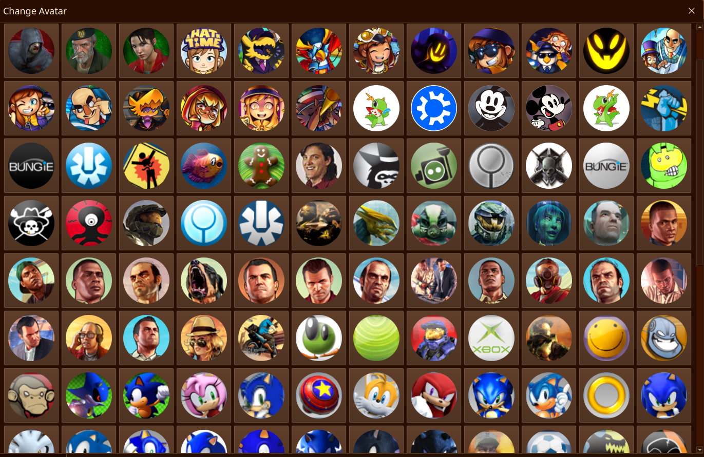

# HAPfPP-for-KDE

It was just a normal day back on November 9, 2026. I was playing around with Kubuntu and found out the avatars that comes with it are just image files in a certain folder you can open. I have a odd thing with PFPs that come with software, so I downloaded the old Xbox 360 PFPs and dropped them in, and they showed up there. Naturally, I would spend the next 3 hours collecting PFPs, sorting them, and then checking my work. I thought "you know, it would be epic and lit to upload these to Github for a dunbo like me who actually cares about this stuff." So, here you go. 

# Install?
Download the repo, then drop all of the folders in ``/usr/share/plasma/avatars``.  You need administrator privileges to do this. After that **make super sure you don't have your settings app open** and run ``systemctl --user restart plasma-plasmashell`` This will restart the Plasma Shell and you should see all of the icons there. 

This should work on anything that uses Plasma, even the Steam Deck. 

# What's included?
Note, some of these don't contain literally every PFP from the game page or whatever. I only included the ones I liked. 

### Xbox 360
- Default PFPs
- Halo 3 (Unfinished)
- Halo: Combat Evolved
- Grand Theft Auto 5 (Unfinished)
- Sonic CD
- Sonic Unleashed
- Sonic The Hedgehog 2006 (Unfinished)

### Steam
- No More Room in Hell

[Sourced here](https://steamcommunity.com/games/224260//Avatar/List)
- A Hat in Time
  
[Sourced here](https://steamcommunity.com/games/AHatinTime/Avatar/List)
  
- Left 4 Dead
  
[Sourced Here](https://steamcommunity.com/games/L4D/Avatar/)

If you're wondering how you download Steam profile pics, most of the time you can just type "steam change avatar "GAME NAME" and it will bring up a page for it. 

### Windows XP
- All of the default icons

### Disney+
I'm not going to add every icon from Disney+ here. I know there was a archive of them on Archive.org but it got taken down. If Disney is that aggressive about just icons, I'm fucked if if I try to do it. I only added 2 I liked.
- Oswald
- Mickey

This is a joke repo btw. 

# Full Name
Huge Ass Repo For Profile Pics for KDE I did in 3 hours while drinking Milo's Sweet Tea MY GOD I AM RUNNING OUT OF THAT GOOD ASS SHIT OH FUCK well I have lemonade too so I have that I have work in the morning thought so I can't be drinking this shit but that's what a pussy says YOLOOOOOOOOOOO FUCK IT DRINK THAT SHIT LIKE A SLUSHIE BITCCHHHHHHH GOD DAMN FUCKKKKKKKKKKKKK
